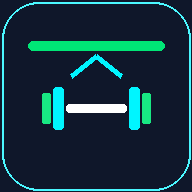
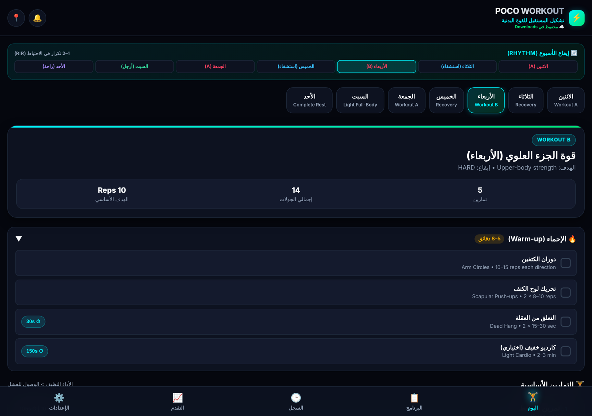
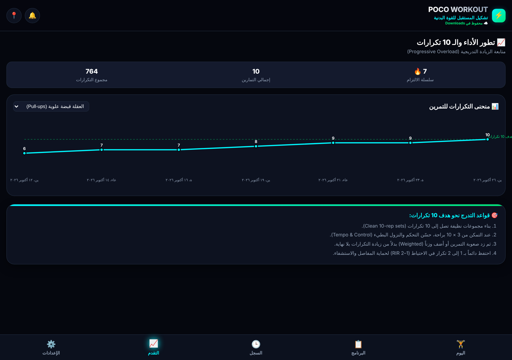
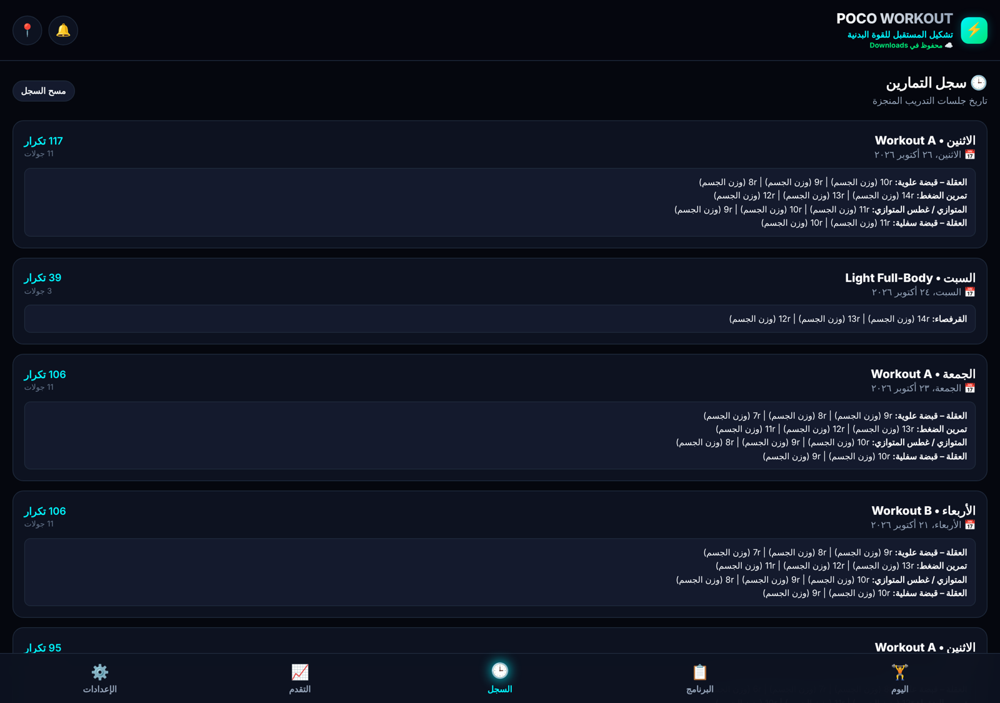
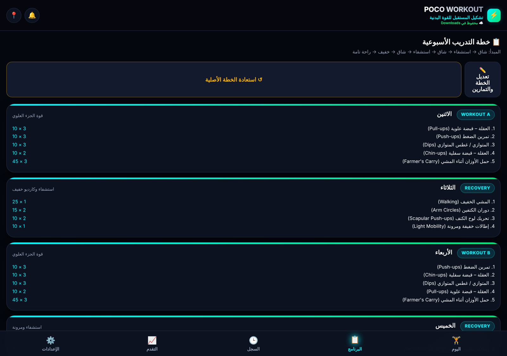
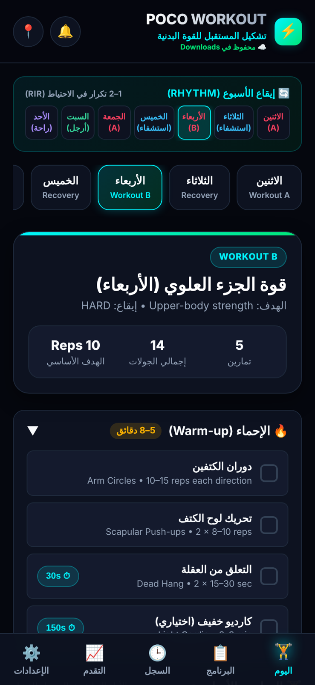
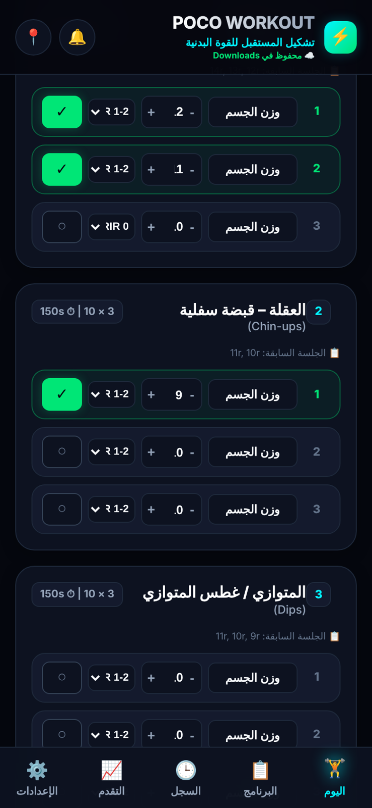
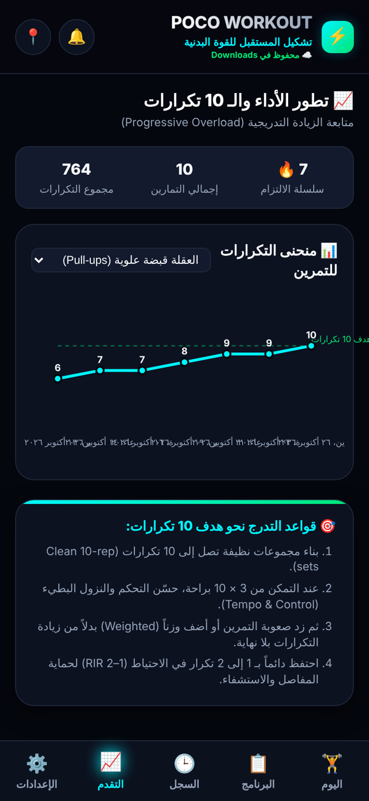

# Poco Workout Tracker

**An Arabic-first, offline-ready workout tracker for clean 10-rep strength training.**

**متتبع تمارين عربي أولاً لبناء القوة البدنية بتكرارات نظيفة ومتقنة.**

## Screenshots

| Today's workout | Progress chart |
|:---:|:---:|
|  |  |
| Weekly rhythm, day selector, session goal and warm-up | Streak, totals and per-exercise rep curve toward the 10-rep target |
| **Workout history** | **Weekly plan** |
|  |  |
| Every completed session with sets, reps and load | Editable 7-day split of hard, recovery and rest days |

| Mobile: today | Mobile: logging sets | Mobile: progress |
|:---:|:---:|:---:|
|  |  |  |

Screenshots use generated demo data.

## Features

| | Feature | |
|:---:|---|---|
| 🏋️ | **Set logging** | Load, reps stepper, RIR and one-tap completion per set |
| ⏱️ | **Rest & warm-up timers** | Auto rest countdown with ±15s/+30s and timed warm-up drills |
| 🔄 | **Weekly rhythm** | Hard / recovery / light / rest days laid out at a glance |
| 📈 | **Progressive overload** | Streak, total reps and per-exercise progression chart |
| 🕒 | **History** | Previous-session hints shown next to each exercise |
| ✏️ | **Plan editor** | Add, edit or reset exercises for any day |
| 💾 | **Local auto-save** | Saves to `workout_progress.json` plus a Markdown log; JSON export/import |
| 📱 | **Installable PWA** | Works on your phone over local Wi-Fi, with offline caching |

## Run

Run `start_app.bat`, then open the local URL it prints. The application stores progress in `workout_progress.json`; this personal history is deliberately excluded from version control.

## Files

- `index.html`, `app.js`, and `styles.css` provide the application interface.
- `serve.py` starts the local server.
- `manifest.json` and `sw.js` support the installable web application.
